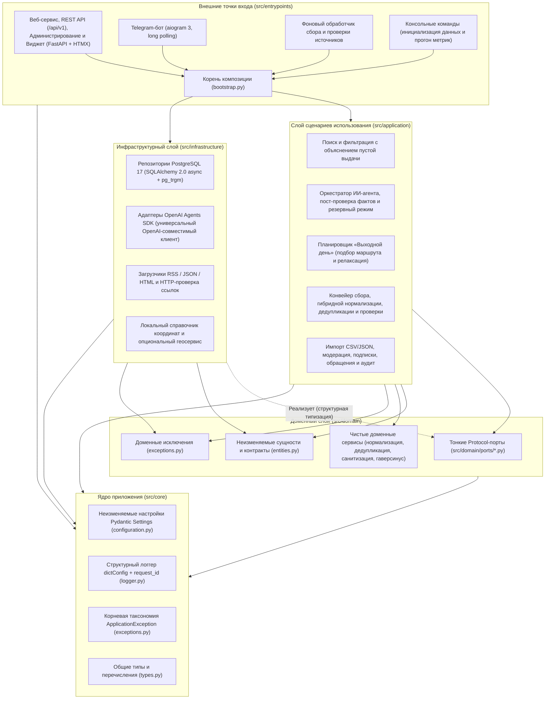
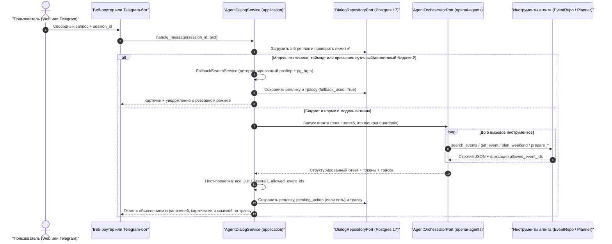
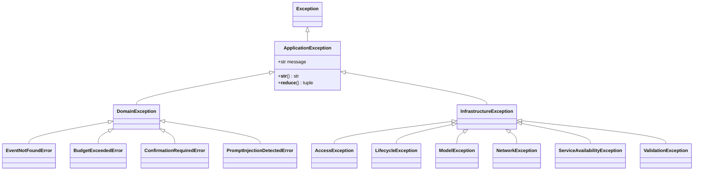

# Архитектура и инженерная спецификация проекта «Афиша культуры Башкортостана» (`cultural-meridian`)

Документ определяет архитектурные принципы, границы модулей, контракты портов, модель данных, требования безопасности и инженерные стандарты проекта **«Афиша культуры Башкортостана»** (целевой уровень исполнения — **Уровень 4 «Контур»**). Документ служит единым руководством при проектировании, реализации, тестировании и ревью изменений в репозитории.

---

## 1. Архитектурная философия и ключевые принципы

Проект строится на основе **лёгкой гексагональной архитектуры (Ports & Adapters)** в сочетании с принципами **Чистой архитектуры**. Цель — получить детерминированный, проверяемый и устойчивый к сбоям сервис за ограниченный срок (2 дня), не зарывая бизнес-логику за многоуровневыми абстракциями, но сохраняя жёсткое разделение контрактов и ввода-вывода.

### Базовые принципы

1. **Правило зависимостей (The Dependency Rule):** исходный код зависит строго снаружи внутрь — от внешних волатильных слоёв (`entrypoints`, `infrastructure`) к внутреннему стабильному ядру (`application`, `domain`, `core`). Внутренние слои ничего не знают о фреймворках (`FastAPI`, `SQLAlchemy`, `aiogram`, `openai-agents`, `httpx`).
2. **Тонкие порты с чёткими границами:** взаимодействия с базой данных, языковыми моделями, внешними источниками афиш, проверкой ссылок и геосервисами оформляются через компактные интерфейсы `typing.Protocol` в `src/domain/ports/`. Каждый порт вынесен в отдельный одноответственный модуль, чтобы границы контрактов не размывались.
3. **Изоляция исключений:** исключения сторонних библиотек (`SQLAlchemyError`, `HTTPError`, ошибки SDK моделей, ошибки сети) не пересекают границы инфраструктурного слоя. Адаптеры транслируют их в единую иерархию `ApplicationException` с сохранением цепочки причин (`raise ... from original_exception`).
4. **Глубокая неизменяемость (Deep Immutability):** доменные сущности, объекты передачи данных, конфигурации и таблицы соответствий неизменяемы по построению (`@dataclass(frozen=True, slots=True, kw_only=True)` или Pydantic `ConfigDict(frozen=True, extra="forbid")`), с защитным преобразованием коллекций в `tuple` и словарей в `types.MappingProxyType`.
5. **Максимальная статическая типизация:** целевая версия — **Python 3.14+**, строгий режим `mypy --strict` (`warn_return_any = true`, `explicit_package_bases = true`), современный синтаксис PEP 695 (`type ... = ...`, `class Box[T]:`) и PEP 604 (`X | Y`, `X | None`), `Final`, `Literal`, `StrEnum`.
6. **Политика полного именования (без сокращений):** в коде, директориях, именах модулей, классов, методов, аргументов и конфигураций используются полные, однозначные слова (например, `event_repository.py`, `language_model`, `administration`, `command_line`, `evaluation`, `deduplication_key`). Единственные исключения — общепринятые протоколы/форматы (`api`, `http`, `html`, `json`, `rss`, `uuid`) и обязательные имена колонок схемы данных из раздела 8.1 технического задания (например, `dedup_key` в таблице БД).
7. **Единый язык документации и версионирования:** вся документация (`ARCHITECTURE.md`, `README.md`), архитектурные обоснования в модулях, Google-style docstrings и коммиты Git ведутся на **техническом русском языке**.

---

## 2. Высокоуровневая топология системы



### Матрица разрешённых зависимостей

| Слой | Путь пакета | Разрешённые внутренние импорты | Сторонние библиотеки |
| :--- | :--- | :--- | :--- |
| **Core** | `src/core` | `src.core.*` | Только примитивы валидации и настроек (`pydantic`, `pydantic-settings`) |
| **Domain** | `src/domain` | `src.core.*`, `src.domain.*` | **Запрещены** для ввода-вывода (только stdlib и `pydantic` для неизменяемых схем) |
| **Application** | `src/application` | `src.core.*`, `src.domain.*`, `src.application.*` | **Запрещены** для ввода-вывода (взаимодействие с внешним миром только через `Protocol`) |
| **Infrastructure** | `src/infrastructure` | `src.core.*`, `src.domain.*`, `src.infrastructure.*` | **Разрешены** (`sqlalchemy`, `asyncpg`, `openai-agents`, `openai`, `httpx`, `feedparser`, `beautifulsoup4`) |
| **Entrypoints** | `src/entrypoints` | `src.core.*`, `src.domain.*`, `src.application.*`, `src.infrastructure.*`, `src.entrypoints.*` | **Разрешены** (`fastapi`, `jinja2`, `aiogram`, `uvicorn`) |
| **Tests** | `tests` | `src.*`, `tests.*` | **Разрешены** (`pytest`, `pytest-asyncio` и тестовые клиенты) |

---

## 3. Структура репозитория

```text
cultural-meridian/
├── .github/
│   └── workflows/
│       └── ci.yaml                                # Автоматические ворота качества (uv, ruff, mypy --strict)
├── configuration/
│   ├── sources.yaml                               # Декларативный реестр внешних и локальных источников афиш
│   └── venues_coordinates.yaml                    # Справочник городов и базовых площадок Башкортостана с координатами
├── data/
│   ├── seed_events.json                           # Подготовленный стартовый набор событий для демонстрации и тестов
│   └── local_feeds/                               # Локальные RSS/JSON/HTML фиды (вкл. кейсы дублей, отмен и инъекций)
├── evaluation/
│   ├── golden_queries.yaml                        # Набор из ≥ 65 контрольных запросов по всем категориям Приложения А
│   ├── external_holdout.yaml                      # 10 изолированных внешних запросов для проверки обобщения
│   └── reports/                                   # Воспроизводимые отчёты прогона (метрики, модель, промпт, стоимость)
├── migrations/                                    # Миграции Alembic для PostgreSQL 17
│   ├── env.py
│   └── versions/
├── src/
│   ├── core/                                      # Сквозное фундаментное ядро
│   │   ├── __init__.py
│   │   ├── configuration.py                       # Неизменяемые Pydantic BaseSettings и кэшированные фабрики
│   │   ├── exceptions.py                          # Корневой ApplicationException и базовые категории сбоев
│   │   ├── logger.py                              # TypedDict-конфигурация logging.config.dictConfig + фильтр request_id
│   │   └── types.py                               # Универсальные PEP 695 алиасы и перечисления StrEnum
│   ├── domain/                                    # Доменные контракты и чистая бизнес-логика
│   │   ├── __init__.py
│   │   ├── entities/                              # Компактные неизменяемые сущности (по областям ответственности)
│   │   │   ├── __init__.py                        # Единый фасад реэкспорта доменных сущностей
│   │   │   ├── administration.py                  # Модерация, аудит, подписки и обращения организаторов
│   │   │   ├── dialog.py                          # Диалог, ИИ-агент, подтверждения, трассировка и лимиты
│   │   │   ├── events.py                          # Мероприятия, источники, поиск, импорт и сбор данных
│   │   │   └── planning.py                        # Геолокация и планировщик «Выходной день»
│   │   ├── exceptions.py                          # Доменные исключения (EventNotFoundError, BudgetExceededError и др.)
│   │   ├── ports/                                 # Чётко разделённые компактные Protocol-порты (один файл — один порт)
│   │   │   ├── __init__.py                        # Единый публичный фасад реэкспорта портов
│   │   │   ├── administration_repository.py       # Порт модерации, аудита, подписок и заявок организаторов
│   │   │   ├── agent_orchestrator.py              # Порт запуска ИИ-агента и контейнер обработчиков инструментов
│   │   │   ├── dialog_repository.py               # Порт истории диалога (≥ 5 реплик), подтверждений и бюджета
│   │   │   ├── event_repository.py                # Порт каталога, поиска, справочников и ETag
│   │   │   ├── geolocation_resolver.py            # Порт определения координат и расчёта времени перемещения
│   │   │   ├── link_checker.py                    # Порт проверки доступности ссылки на источник
│   │   │   ├── raw_event_repository.py            # Порт хранения сырых данных источников и переигрывания нормализации
│   │   │   ├── source_fetcher.py                  # Порт чтения событий из внешнего источника
│   │   │   └── structured_extractor.py            # Порт извлечения сложных полей через языковую модель со structured output
│   │   └── services/                              # Чистые функции доменной области (без ввода-вывода)
│   │       ├── __init__.py
│   │       ├── deduplication.py                   # Вычисление dedup_key, source_hash и коэффициента совпадения
│   │       ├── normalization.py                   # Детерминированная нормализация заголовков, дат, цен, городов и возраста
│   │       ├── sanitization.py                    # Изоляция и обнаружение промпт-инъекций во внешних текстах
│   │       └── travel_estimator.py                # Расчёт расстояния по гаверсинусу и времени городского перемещения
│   ├── application/                               # Одноответственные сценарии использования и конвейеры
│   │   ├── __init__.py
│   │   ├── administration.py                      # Сценарии модерации, редактирования, снятия отменённых и журнала изменений
│   │   ├── agent_dialog.py                        # Оркестрация диалога, пост-валидация UUID, подтверждение и фоллбэк
│   │   ├── event_importer.py                      # Идемпотентный импорт CSV/JSON с отчётом (добавлено/обновлено/отклонено)
│   │   ├── event_ingestion.py                     # Конвейер сбора: сырая запись → гибридная нормализация → дедупликация → проверка
│   │   ├── fallback_search.py                     # Детерминированный разбор свободного запроса и резервный поиск
│   │   ├── search_events.py                       # Фильтрация, пагинация и диагностика пустой выдачи
│   │   ├── subscriptions.py                       # Подписки/отписки (удаление данных) и заявки организаторов
│   │   └── weekend_planner.py                     # Алгоритм планировщика «Выходной день» (2–4 события, без пересечений)
│   ├── infrastructure/                            # Конкретные реализации доменных портов
│   │   ├── __init__.py
│   │   ├── database/                              # Слой PostgreSQL 17 (SQLAlchemy 2.0 async + asyncpg)
│   │   │   ├── __init__.py
│   │   │   ├── administration_repository.py
│   │   │   ├── dialog_repository.py
│   │   │   ├── engine.py
│   │   │   ├── event_repository.py
│   │   │   ├── raw_event_repository.py
│   │   │   └── tables.py
│   │   ├── geolocation/                           # Реализация геосервиса
│   │   │   ├── __init__.py
│   │   │   └── resolver.py                        # Справочник coordinates + опциональный внешний запрос с фоллбэком
│   │   ├── language_model/                        # Универсальный ИИ-контур поверх OpenAI Agents SDK
│   │   │   ├── __init__.py
│   │   │   ├── agent_orchestrator.py              # Реализация AgentOrchestratorPort (max_turns=5)
│   │   │   ├── client.py                          # Фабрика OpenAI-совместимого клиента (замена модели 1 строкой в .env)
│   │   │   ├── cost_calculator.py                 # Расчёт стоимости вызова в рублях по таблице тарифов
│   │   │   ├── guardrails.py                      # Input/Output guardrails против утечки промпта и галлюцинаций
│   │   │   ├── structured_extractor.py            # Реализация StructuredExtractorPort на быстрой модели
│   │   │   └── tools.py                           # Инструменты агента (@function_tool) со строгим JSON-контрактом
│   │   └── sources/                               # Сборщики и проверщики внешних источников
│   │       ├── __init__.py
│   │       ├── html_fetcher.py
│   │       ├── json_fetcher.py
│   │       ├── link_checker.py
│   │       ├── registry.py
│   │       └── rss_fetcher.py
│   └── entrypoints/                               # Внешние интерфейсы и корень композиции
│       ├── __init__.py
│       ├── bootstrap.py                           # Единый Composition Root и управление жизненным циклом ресурсов
│       ├── background_worker/
│       │   ├── __init__.py
│       │   └── runner.py                          # Планировщик регулярного сбора и проверки источников
│       ├── command_line/
│       │   ├── __init__.py
│       │   ├── evaluate.py                        # Прогон ≥ 65 запросов, сравнение с baseline и отчёт по метрикам 9.2
│       │   └── seed.py                            # Идемпотентная загрузка подготовленных данных и справочников
│       ├── telegram_bot/
│       │   ├── __init__.py
│       │   ├── formatting.py                      # Рендеринг карточек, объяснений и дисклеймера в Markdown/HTML Telegram
│       │   ├── handlers.py                        # /start, фильтры, пагинация, подписки, подтверждения, свободный запрос
│       │   ├── keyboards.py                       # Инлайн-клавиатуры без «простыни» текста
│       │   └── runner.py                          # Запуск aiogram 3 long polling (режим ожидания при пустом токене)
│       └── web/
│           ├── __init__.py
│           ├── administration.py                  # Роутер админ-панели (/admin)
│           ├── api.py                             # Единый модуль REST API с внутренним версионированием (/api/v1/*)
│           ├── application.py                     # Инициализация FastAPI, OpenAPI 3.1, /health, /metrics
│           ├── middleware.py                      # Контекст request_id, ограничение частоты запросов, заголовки безопасности
│           ├── pages.py                           # SSR/HTMX страницы каталога, карточки, планировщика, чата и формы
│           ├── widget.py                          # Встраиваемый /widget (iframe) и /widget.js (без сторонних cookies)
│           ├── static/                            # Адаптивные стили (от 360px, контраст ≥ 4.5:1) и изолированный widget.js
│           └── templates/                         # Шаблоны Jinja2 + HTMX
├── tests/
│   ├── conftest.py                                # Общие фикстуры и изолированные настройки тестовой среды
│   ├── unit/                                      # Быстрые детерминированные тесты ядра, домена и сценариев (без I/O)
│   ├── contract/                                  # Контрактные тесты соответствия адаптеров Protocol-портам
│   └── integration/                               # Интеграционные тесты PostgreSQL 17, REST API, виджета, импорта и сбора
├── .env.example                                   # Шаблон всех переменных окружения (без секретов)
├── .pre-commit-config.yaml                        # Хуки ruff, mypy, gitleaks, uv-lock, pip-audit
├── ARCHITECTURE.md                                # Настоящая архитектурная спецификация
├── DEMO_SCRIPT.md                                 # Пошаговый сценарий демонстрации на 5 минут
├── Dockerfile                                     # Образ приложения на Python 3.14 + uv
├── README.md                                      # Фиксация Уровня 4, запуск за ≤ 10 мин, модель, стоимость, ПДн и решения
├── docker-compose.yml                             # Сервисы: database, local_feeds, web_api, telegram_bot, background_worker
├── pyproject.toml                                 # Зависимости, конфигурация ruff и mypy --strict
└── uv.lock                                        # Зафиксированное дерево зависимостей
```

---

## 4. Границы портов и инфраструктурные адаптеры

Каждый порт в `src/domain/ports/` отвечает строго за один внешний аспект и определяет асинхронный `Protocol` с ключевыми аргументами (`*`) и доменными исключениями.

| Порт (`src/domain/ports/`) | Ответственность | Реализация (`src/infrastructure/`) | Гарантия устойчивости / фоллбэка |
| :--- | :--- | :--- | :--- |
| `event_repository.py` (`EventRepositoryPort`) | Поиск, фильтрация (`pg_trgm` + FTS), карточки, справочники, дедупликация | `database/event_repository.py` | Отменённые события исключаются из выдачи, но доступны по прямой ссылке |
| `raw_event_repository.py` (`RawEventRepositoryPort`) | Сохранение сырых записей источников и выборка для переигрывания нормализации | `database/raw_event_repository.py` | Идемпотентность по `(source_id, source_hash)` |
| `dialog_repository.py` (`DialogRepositoryPort`) | Память диалога (≥ 5 реплик), отложенные подтверждения, трассы и суточный бюджет ₽ | `database/dialog_repository.py` | Атомарное списание расхода и удаление подтверждения после выполнения |
| `administration_repository.py` (`AdministrationRepositoryPort`) | Очередь модерации, журнал изменений, подписки и заявки организаторов | `database/administration_repository.py` | Физическое удаление подписки при отписке |
| `agent_orchestrator.py` (`AgentOrchestratorPort`, `AgentToolCallbacks`) | Выполнение хода диалога ИИ-агента с прикладными колбэками инструментов и возврат трассы | `language_model/agent_orchestrator.py` | Таймаут/ошибка модели или лимит бюджета переводят запрос на `fallback_search.py` |
| `structured_extractor.py` (`StructuredExtractorPort`) | Извлечение полей сложных событий со строгим `structured output` | `language_model/structured_extractor.py` | При недоступности модели конвейер продолжает работу на правилах и отправляет карточку в модерацию |
| `source_fetcher.py` (`SourceFetcherPort`) | Загрузка и первичный разбор элементов из RSS, JSON API и HTML-страниц | `sources/{rss,json,html}_fetcher.py` | Ошибка одного источника логируется и не останавливает сбор по остальным |
| `link_checker.py` (`LinkCheckerPort`) | Проверка доступности `source_url` (HTTP 2xx/3xx) с коротким таймаутом | `sources/link_checker.py` | Недоступная ссылка переводит событие в очередь модерации вместо публикации |
| `geolocation_resolver.py` (`GeolocationResolverPort`) | Координаты города/площадки и оценка времени перемещения в минутах | `geolocation/resolver.py` | Локальный справочник + гаверсинус работают при полном отказе внешнего геосервиса |

---

## 5. Ключевые потоки выполнения

### 5.1. Сквозной поток диалога ИИ-агента и резервного режима



### 5.2. Поток сбора, гибридной нормализации и проверки данных (Уровень 4)

```mermaid
flowchart LR
    Sources["configuration/sources.yaml (RSS, JSON API, HTML, local_feeds)"] --> Fetcher["SourceFetcherPort (изоляция сетевых сбоев)"]
    Fetcher --> RawStorage["raw_events (сырая запись + source_hash)"]
    RawStorage --> Sanitizer["SanitizationService (пометка угроз инъекций)"]
    Sanitizer --> RuleNormalizer["Детерминированная нормализация (даты, цены, город, возраст)"]
    RuleNormalizer --> ConfidenceCheck{"Все поля ясны и confidence ≥ 0.75?"}
    ConfidenceCheck -- "Да" --> Deduplicator["DeduplicationService (dedup_key + pg_trgm)"]
    ConfidenceCheck -- "Нет" --> FastModelExtractor["StructuredExtractorPort (быстрая модель, frozen Pydantic schema)"]
    FastModelExtractor --> Deduplicator
    Deduplicator --> LinkAndDateCheck["LinkCheckerPort (HTTP 2xx/3xx) + дата в будущем + анти-инъекция"]
    LinkAndDateCheck -- "Все проверки пройдены" --> PublishEvent["events (status='published') + event_sources"]
    LinkAndDateCheck -- "Спорные поля / битая ссылка / подозрение" --> ModerationQueue["events (status='draft') + moderation_queue"]
```



---

## 6. Таксономия исключений и изоляция ошибок



### Правила обработки ошибок
- Все ошибки в коде наследуются от `ApplicationException` (`src/core/exceptions.py`), который автоматически форматирует непустые ключевые атрибуты в `__str__` и гарантирует корректную сериализацию через `__reduce__`.
- **Запрещено перехватывать `BaseException`** (включая `asyncio.CancelledError`, `KeyboardInterrupt`, `SystemExit`).
- В `src/entrypoints/web/api.py` централизованный обработчик исключений преобразует `ApplicationException` в единый JSON-формат `ErrorResponse(code, message, details, request_id)` с корректным HTTP-кодом (`400`, `404`, `422`, `429`, `503`), никогда не раскрывая трассировку стека или внутренние детали пользователю.

---

## 7. База данных (PostgreSQL 17) и контракты данных

В стартовой миграции Alembic активируются расширения **`pg_trgm`** (для устойчивости к опечаткам вроде *«стерлитакмае»*) и **`unaccent`**.

1. **Сырые данные и источники:**
   - `raw_events`: хранит необработанный JSON/текст внешнего источника (`source_name`, `external_identifier`, `source_url`, `source_hash`, `raw_payload` JSONB, `fetched_at`, `normalization_status`), что позволяет переигрывать нормализацию без повторного обхода сайтов.
2. **Нормализованный каталог (`events`):**
   - Содержит все 24 поля схемы из раздела 8.1 ТЗ (`id`, `title`, `normalized_title`, `category`, `tags`, `date_start`, `date_end`, `duration_min`, `city`, `venue`, `address`, `lat`, `lon`, `description`, `price_min`, `price_max`, `is_free`, `age_limit`, `language`, `org_link`, `source_url`, `source_type`, `source_hash`, `verified_at`, `confidence`, `status`, `dedup_key`, `created_at`, `updated_at`).
   - Индексы: `GIN` с `gin_trgm_ops` по `normalized_title`, `city`, `venue`; `GIN` по `to_tsvector('russian', title || ' ' || description)`; составные B-Tree индексы по `(status, city, date_start)` и `(dedup_key)`.
   - Отменённые события (`status = 'canceled'`) автоматически исключаются из публичного поиска и планировщика, но открываются по прямой ссылке с явным предупреждением об отмене.
3. **Связь источников (`event_sources`):**
   - При сведении дубликатов из разных источников в одну карточку сохраняются все подтверждённые источники (`source_name`, `source_url`, `source_hash`, `verified_at`), и их список отображается на карточке события.
4. **Сопроводительные таблицы:**
   - `cities`, `venues`, `categories` — нормализованные справочники.
   - `moderation_queue` — спорные карточки, потенциальные дубли и записи с флагом подозрительного контента.
   - `audit_logs` — журнал изменений (`actor`, `action`, `entity_type`, `entity_id`, `changes_json`, `created_at`).
   - `subscriptions` — минимальные данные подписки (`channel`, `subscriber_identifier`, `city`, `category`, `created_at`); при отписке запись удаляется физически (`DELETE`).
   - `feedback_requests` — заявки организаторов с защитой от спама.
   - `dialog_sessions`, `dialog_messages`, `pending_actions` — история диалога (≥ 5 реплик) и токены подтверждения изменяющих действий.
   - `agent_traces` — полная трасса каждого ответа агента (исходный запрос, план, инструменты и аргументы, идентификаторы записей-оснований, задержка, токены, стоимость в ₽, модель, версия промпта).
   - `llm_usage_daily` — суточный учёт затрат в ₽ на пользователя и глобально для автоматического переключения в резервный режим.

---

## 8. Универсальная конфигурация моделей, безопасность и логирование

### 8.1. Замена моделей одной строкой в `.env`
`LanguageModelSettings` в `src/core/configuration.py` работает с любым OpenAI-совместимым эндпоинтом через `AsyncOpenAI(base_url=..., api_key=...)` и `OpenAIChatCompletionsModel` из `openai-agents`. Переключение между быстрыми не-OpenAI моделями (например, `gemini-3.5-flash-lite`, `gemini-4-hydrogen`, `claude-sonnet-5.5` или локальным `vllm`) выполняется изменением одной переменной в `.env` без правки кода:
- `LANGUAGE_MODEL_BASE_URL`
- `LANGUAGE_MODEL_API_KEY`
- `LANGUAGE_MODEL_PRIMARY` (основная диалоговая модель)
- `LANGUAGE_MODEL_FAST` (лёгкая модель для сложной гибридной нормализации и опциональной оценки объяснений)
- `LANGUAGE_MODEL_PRICING_JSON` (тарифы в рублях за 1M токенов для точного расчёта стоимости диалога)

### 8.2. Защита от инъекций, галлюцинаций и несанкционированных мутаций
1. **Изоляция недоверенных данных:** описания событий из внешних источников проходят через `SanitizationService` (обнаружение характерных директив перехвата роли/инструкций) и передаются в модель строго внутри тегов `<untrusted_event_data>...</untrusted_event_data>`.
2. **Пост-валидация фактов (0 выдуманных событий):** на каждом шаге диалога фиксируется множество UUID событий, возвращённых инструментами (`allowed_event_ids`). Если структурированный ответ агента ссылается на идентификатор вне `allowed_event_ids` — ссылка отбрасывается, а ответ пересобирается детерминированно из подтверждённых записей.
3. **Двухшаговое подтверждение изменяющих действий:** инструменты `prepare_subscribe` и `prepare_feedback` только регистрируют `pending_action` и возвращают пользователю кнопки/запрос подтверждения. Запись в БД происходит исключительно после явного подтверждения пользователем.
4. **Обязательный дисклеймер:** веб-страницы, виджет и Telegram-бот явно информируют пользователя о том, что сервис является независимым информационным контуром афиши и не подменяет официальный портал Министерства культуры РБ.

### 8.3. Логгер (`src/core/logger.py`)
Реализуется по образцу эталонного проекта (`dictConfig` на основе `RootLoggerConfiguration` и `LoggingConfiguration` в `TypedDict`) с добавлением `RequestIdentifierFilter` через `contextvars.ContextVar`:
- Стандартный консольный вывод в `stdout` с `request_id`, уровнем, именем модуля и строкой кода.
- Опциональное файловое логирование (`application.log`, `errors.log`) с поддержкой подробного формата.
- Получение логгеров исключительно через `get_logger(__name__)`; прямое использование `print()` запрещено правилом `T20` в `ruff`.
- Персональные данные (токены, тексты обращений, идентификаторы пользователей вне хэша/номера запроса) в логи не записываются.

---

## 9. Стандарты кода, документации и версионирования Git

- **Инструменты проверки:** `ruff` (длина строки `120`, двойные кавычки, `skip-magic-trailing-comma = true`, запрет относительных импортов `TID252`, обязательный `pathlib.Path` `PTH`, `ASYNC`, `T20`, `D` по конвенции Google) и `mypy --strict`.
- **Публичные контракты модулей:** каждый модуль объявляет отсортированный `__all__ = [...]` (`RUF022`) и использует только абсолютные импорты `from src.*`.
- **Google-style docstrings на русском языке:** обязательны для всех пакетов, модулей, классов, протоколов, датаклассов, исключений, функций и методов. Секции `Attributes:`, `Arguments:`, `Returns:`, `Raises:` оформляются без дублирования типов из аннотаций.
- **Архитектурные решения в коде:** обоснования выбора технологий и границ применимости фиксируются в докстрингах ключевых модулей (например, `src/infrastructure/language_model/agent_orchestrator.py`, `src/application/weekend_planner.py`, `src/infrastructure/database/event_repository.py`) и кратко сводятся в `README.md`.
- **Конвенция Git-коммитов (на русском языке):** формат `<тип>(<область>): <краткое описание на русском>` с маркированным списком изменений в теле коммита (`- ...`), аналогично истории репозитория (`ci(github, quality): ...`, `chore(env, pre-commit): ...`).

---

## 10. Стратегия тестирования и ворота качества

1. **Модульные тесты (`tests/unit/`):** детерминированная и гибридная нормализация, расчёт `dedup_key`, санитизация инъекций, алгоритм «Выходной день» (включая диагностику конфликтов), пост-валидация идентификаторов (0 выдумок), резервный поиск и переключение по бюджету/ошибке.
2. **Контрактные тесты (`tests/contract/`):** проверка соблюдения интерфейсов `EventRepositoryPort`, `DialogRepositoryPort`, `AgentOrchestratorPort`, `GeolocationResolverPort` всеми адаптерами и тестовыми двойниками.
3. **Интеграционные тесты (`tests/integration/`):** реальный PostgreSQL 17 (`pg_trgm`, миграции, поиск с опечатками), REST API в `api.py` (`ETag`, формат ошибок, `/health`, `/metrics`), виджет без cookies, идемпотентный импорт 100 событий (100% без дублей), сбор из локальных RSS/JSON/HTML фидов.
4. **Контур оценки Уровня 4 (`src/entrypoints/command_line/evaluate.py`):**
   - Прогон ≥ 65 контрольных запросов (`evaluation/golden_queries.yaml`) и 10 изолированных запросов (`evaluation/external_holdout.yaml`) против агента и против базового поиска по ключевым словам.
   - Гибридная проверка: детерминированные проверки фактов, UUID, аргументов инструментов по трассе, честных отказов, отмен, устойчивости к 10+ инъекциям, задержки p95 и стоимости в ₽ + опциональный LLM-judge на быстрой модели для оценки качества объяснений и уточнений.
   - Фиксация в отчёте версии промпта, имён моделей, даты и средней стоимости диалога в рублях.
5. **Обязательные команды перед каждым коммитом и релизом:**
   - `uv lock --check` и `uv sync --locked`
   - `uv run ruff format --check`
   - `uv run ruff check`
   - `uv run mypy src`
   - `uv run pytest`
